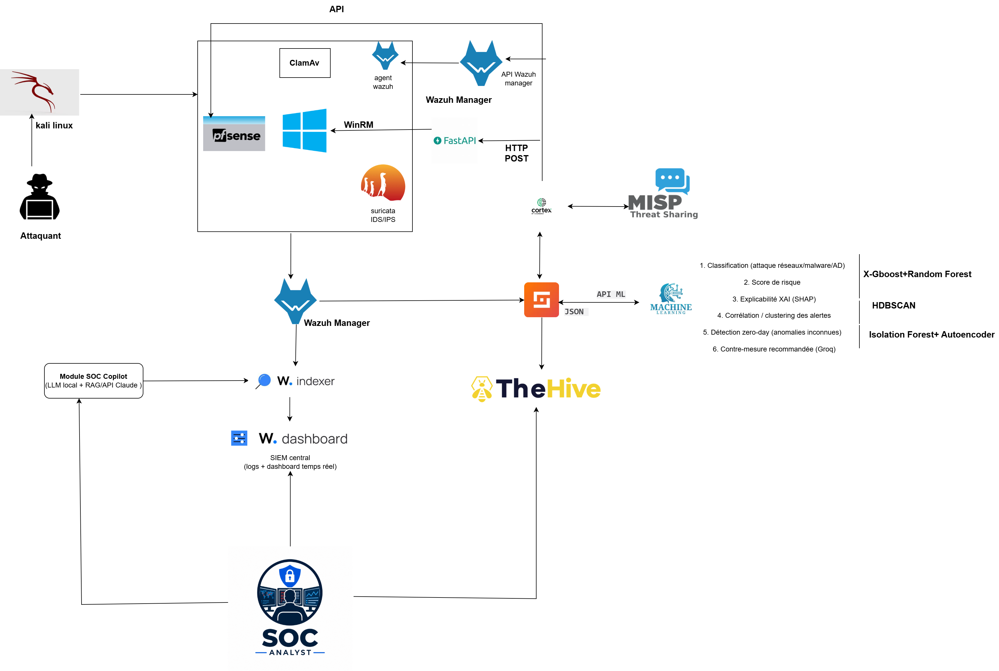

# 🧠 Intelligent SOC : détection et réponse automatisée aux incidents

> SOC qui combine Wazuh, Suricata, machine learning et SOAR pour détecter les
> attaques réseau et les malwares, évaluer le risque et déclencher une réponse
> automatisée.

> 🚧 **Statut : phase de conception.** Ce dépôt contient pour l'instant
> l'architecture cible. L'implémentation n'a pas encore commencé.

## Contexte
Projet d'équipe [année]. Objectif : construire un SOC où les alertes ne sont pas
seulement collectées, mais classées, expliquées et traitées automatiquement,
avec un analyste humain qui garde la décision finale.

## Architecture cible

Le fichier source du schéma (`architecture.drawio`) est disponible dans le dépôt
pour être modifié avec draw.io.

### Flux prévu
1. Un attaquant (Kali Linux) cible l'environnement protégé par **pfSense**.
2. **Suricata** (IDS/IPS) analyse le trafic. Les agents **Wazuh** et **ClamAV**
   surveillent les postes (dont une machine Windows).
3. Les événements remontent au **Wazuh Manager**, puis sont indexés et affichés
   dans le **Wazuh Dashboard** (SIEM central).
4. Les alertes sont envoyées à **Shuffle** (SOAR), qui les enrichit avec
   **Cortex** et **MISP** (renseignement sur les menaces).
5. Shuffle interroge un **module de machine learning** (API ML, échanges JSON).
6. Un incident est créé dans **TheHive** pour l'analyste SOC.
7. Une contre-mesure peut être déclenchée via une **API FastAPI**
   (requête HTTP POST, puis commande WinRM sur la machine Windows).
8. Un **SOC Copilot** (LLM local + RAG, ou API) aide l'analyste à interpréter
   les alertes indexées.

## Module de machine learning prévu
| # | Fonction | Technique envisagée |
|---|---|---|
| 1 | Classification (attaque réseau, malware, Active Directory) | XGBoost + Random Forest |
| 2 | Score de risque | [à définir] |
| 3 | Explicabilité des décisions | SHAP (XAI) |
| 4 | Corrélation et regroupement des alertes | HDBSCAN |
| 5 | Détection zero-day (anomalies inconnues) | Isolation Forest + Autoencoder |
| 6 | Recommandation de contre-mesure | LLM via Groq |

## Composants
| Composant | Rôle |
|---|---|
| pfSense | Pare-feu, segmentation |
| Suricata | Détection d'intrusion réseau |
| Wazuh (manager, indexer, dashboard) | SIEM, collecte et visualisation |
| ClamAV | Détection de malwares sur les postes |
| Shuffle | Orchestration et automatisation (SOAR) |
| TheHive, Cortex, MISP | Gestion d'incidents, analyse, threat intelligence |
| FastAPI | API de réponse automatisée |
| Python (scikit-learn, XGBoost, SHAP) | Modèles de détection |

## Feuille de route
- [x] Conception de l'architecture
- [ ] Déploiement de l'infrastructure (pfSense, Wazuh, Suricata)
- [ ] Intégration Wazuh → Shuffle → TheHive
- [ ] Jeu de données et entraînement des modèles
- [ ] API ML et score de risque
- [ ] Réponse automatisée (FastAPI, WinRM)
- [ ] SOC Copilot
- [ ] Scénarios d'attaque simulés et évaluation (précision, faux positifs)

## Ma part dans le projet
[À compléter : les modules dont tu es responsable]

## Limites
Projet en cours : aucune performance n'est encore mesurée. Les technologies
listées sont des choix de conception susceptibles d'évoluer.

## Équipe
- Hamza Jbeli
- Harzli Narje
- Belgacem Salma
